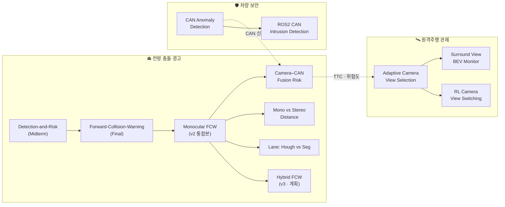

  

<h1 align="center">전양호 (Yangho Jeon)</h1>
<h3 align="center">🚗 카메라와 차량 신호로 도로 위 위험을 읽는 AI 엔지니어 지망생</h3>

  충북대학교 산업인공지능학과 석사과정에서 <b>자율주행 인지 · ADAS · 원격주행 관제 · 산업 비전</b>을 공부합니다. 
  고전 영상처리부터 딥러닝 · 강화학습까지 <b>같은 문제를 여러 방법으로 풀고, 정답 데이터로 정량 비교</b>하는 것을 좋아합니다.

  
  
  

---

## 🔭 연구 관심 분야 (Focus Areas)

| | 분야 | 무엇을 하나요 |
|:---:|---|---|
| 🚘 | **전방 인지 · ADAS** | 단안/스테레오 거리 추정, TTC 기반 충돌 위험 등급화, 차선 · 주행가능영역 검출 |
| 📡 | **센서 융합 · 차량 보안** | 카메라 + CAN 신호 융합, CAN 버스 공격 탐지와 ROS 2 실시간 배포 |
| 🛰️ | **원격주행 관제** | 6채널 카메라 뷰 선택(지도학습 · 강화학습), 서라운드 BEV 합성 |
| 🏭 | **산업 비전 · 예측** | 제조 외관 결함 검사, 운전자 졸음 감지, CCTV 교통량 · 공공자전거 수요 예측 |

---

## 🏆 주요 성과 (Highlights)

> 공개 데이터셋의 정답 라벨로 직접 측정한 수치입니다. 자세한 실험 조건은 각 저장소의 보고서에 있습니다.

| 프로젝트 | 데이터 | 핵심 결과 |
|---|---|---|
| 📡 [**Camera–CAN Fusion Risk**](https://github.com/cbnu-yhjeon/Camera-CAN-Fusion-Risk) | nuScenes 850 scene | CAN 자차 속도를 넣은 IMM 필터로 **TTC MAE 3.36 s → 0.97 s** |
| 🏭 [**Visual Defect Inspection**](https://github.com/cbnu-yhjeon/Visual-Defect-Inspection-Benchmark) | MVTec AD 15종 | 불량 사진 **0장**으로 PatchCore 이미지 AUROC **0.979**, PRO **0.928** |
| 🛣️ [**Lane: Hough vs Segmentation**](https://github.com/cbnu-yhjeon/Lane-Hough-vs-Segmentation) | BDD100K 10,000장 | 자차 차로 IoU **0.220 → 0.799**, 위험 등급 오판 **17.2% → 3.8%** |
| 🔭 [**Mono vs Stereo Distance**](https://github.com/cbnu-yhjeon/Mono-Stereo-Distance-Estimation) | KITTI 객체 12,783개 | 단안 핀홀 vs 스테레오 정확도 교차 거리 **≈ 33 m** 실측 |
| 🛡️ [**ROS2 CAN Intrusion Detection**](https://github.com/cbnu-yhjeon/ROS2-CAN-Intrusion-Detection) | HCRL CAN 로그 (vcan0 재생) | 오프라인 ↔ 실시간 노드 F1 차이 **0.08 %p 이내** (68회 실행) |
| 😴 [**Driver Drowsiness Monitoring**](https://github.com/cbnu-yhjeon/Driver-Drowsiness-Monitoring) | 웹캠 · 공개 데이터 | 1스레드 CPU에서 **79 FPS** (목표 15 FPS) |
| 📈 [**CCTV Traffic Forecasting**](https://github.com/cbnu-yhjeon/CCTV-Traffic-Volume-Forecasting) | CCTV 영상 · UCI Metro | 차량 카운팅 **30/30**, 예측 MAE 기준선 대비 **−42.3 %** |

---

## 🧭 프로젝트 지도 (Project Map)

한 프로젝트의 한계가 다음 프로젝트의 질문이 되도록 이어서 진행하고 있습니다.

---

## 📂 전체 저장소 (All Repositories)

**상태:** ✅ 완료 · 🚧 진행 중 · 📝 설계 단계 · 📚 강의 아카이브

### 🚘 전방 인지 · ADAS

| 저장소 | 내용 | 기술 | 상태 |
|---|---|---|:---:|
| [Hybrid-Forward-Collision-Warning](https://github.com/cbnu-yhjeon/Hybrid-Forward-Collision-Warning) | FCW v2의 검출 단계만 딥러닝(YOLO)으로 교체하고 KITTI 3D 라벨로 v1 · v2 · v3 정량 비교 | YOLO · KITTI | 📝 |
| [Mono-Stereo-Distance-Estimation](https://github.com/cbnu-yhjeon/Mono-Stereo-Distance-Estimation) | 단안 핀홀 · 스테레오 시차(SGBM) · 단안 깊이(Depth Anything V2) 거리 오차 비교 | OpenCV · KITTI | ✅ |
| [Camera-CAN-Fusion-Risk](https://github.com/cbnu-yhjeon/Camera-CAN-Fusion-Risk) | 영상 + CAN(속도 · 브레이크 · 조향) 융합으로 TTC 보정, near-miss 자동 탐색 | Kalman/IMM · nuScenes | ✅ |
| [Lane-Hough-vs-Segmentation](https://github.com/cbnu-yhjeon/Lane-Hough-vs-Segmentation) | 고전 Hough 차선 검출 vs 의미 분할, 차선 오류가 위험 등급에 번지는 정도 추적 | OpenCV · YOLOP · BDD100K | ✅ |
| [monocular-forward-collision-warning](https://github.com/cbnu-yhjeon/monocular-forward-collision-warning) | 딥러닝 없이 고전 영상처리만으로 SAFE / CAUTION / DANGER 위험 등급화 (Midterm + Final 통합본) | OpenCV | ✅ |
| [Forward-Collision-Warning-System](https://github.com/cbnu-yhjeon/Forward-Collision-Warning-System) | 전방 위험 탐지 시스템 Final 고도화 버전 | OpenCV | ✅ |
| [Detection-and-Risk-Classification](https://github.com/cbnu-yhjeon/Detection-and-Risk-Classification) | 단안 카메라 기반 전방 위험 객체 탐지 · 위험도 등급화 (Midterm 버전) | OpenCV | ✅ |
| [Driver-Drowsiness-Monitoring](https://github.com/cbnu-yhjeon/Driver-Drowsiness-Monitoring) | 고전 검출기 + 경량 CNN + 시간축 판단으로 깜빡임과 졸음을 구분하는 DMS | OpenCV · CNN | ✅ |

### 🛡️ 차량 네트워크 보안

| 저장소 | 내용 | 기술 | 상태 |
|---|---|---|:---:|
| [ROS2-CAN-Intrusion-Detection](https://github.com/cbnu-yhjeon/ROS2-CAN-Intrusion-Detection) | 학습된 CAN 이상탐지 모델을 SocketCAN `vcan0` + ROS 2 노드로 실시간 배포, 지연 · 처리량 측정 | ROS 2 · SocketCAN · Docker | ✅ |
| [PROJECT-CAN-Anomaly-Detection](https://github.com/cbnu-yhjeon/PROJECT-CAN-Anomaly-Detection) | DoS · Fuzzy · Gear · RPM 공격 탐지를 위한 XGBoost / Isolation Forest / LSTM-AE 비교 | XGBoost · PyTorch | ✅ |

### 🛰️ 원격주행 관제

| 저장소 | 내용 | 기술 | 상태 |
|---|---|---|:---:|
| [Adaptive-Camera-View-Selection-System](https://github.com/cbnu-yhjeon/Adaptive-Camera-View-Selection-System) | 영상 + CAN + 객체 위험도 융합으로 "지금 가장 중요한 카메라 뷰"를 고르는 딥러닝 모델 (의사 라벨 자동 생성) | PyTorch · nuScenes | 🚧 |
| [RL-Camera-View-Switching](https://github.com/cbnu-yhjeon/RL-Camera-View-Switching) | 화면 깜빡임과 위험 누락을 함께 고려하는 강화학습 뷰 전환 정책 (로그 재생 MDP) | RL · PyTorch | ✅ |
| [Surround-View-BEV-Monitor](https://github.com/cbnu-yhjeon/Surround-View-BEV-Monitor) | 6채널 카메라를 IPM으로 버드아이뷰 한 장에 합성하고 TTC 색으로 위험 객체 표시 | OpenCV · nuScenes | ✅ |

### 🏭 산업 비전 · 수요 예측

| 저장소 | 내용 | 기술 | 상태 |
|---|---|---|:---:|
| [Visual-Defect-Inspection-Benchmark](https://github.com/cbnu-yhjeon/Visual-Defect-Inspection-Benchmark) | 제조 외관 결함 검사: 고전 영상처리 vs 지도 CNN vs 비지도 이상탐지(PatchCore) | PyTorch · MVTec AD | ✅ |
| [CCTV-Traffic-Volume-Forecasting](https://github.com/cbnu-yhjeon/CCTV-Traffic-Volume-Forecasting) | CCTV 차량 검출 · 추적 · 카운팅 → 기상 · 달력 특징으로 시간대별 교통량 예측 + SHAP 해석 | YOLO11 · XGBoost · LightGBM · SHAP | ✅ |
| [PROJECT-Bicyle-Demand-Forecasting](https://github.com/cbnu-yhjeon/PROJECT-Bicyle-Demand-Forecasting) | 따릉이 · UCI Bike Sharing + 기상 데이터로 공공자전거 시간대별 수요 예측 (4인 팀) | XGBoost · LightGBM · SHAP | ✅ |
| [PROJECT-Breed-Recognition-Program](https://github.com/cbnu-yhjeon/PROJECT-Breed-Recognition-Program) | MobileNetV2 전이학습으로 강아지 사진의 견종 Top-5 인식 | TensorFlow · Keras | ✅ |
| [PROJECT-Handwriting-recognition-programs](https://github.com/cbnu-yhjeon/PROJECT-Handwriting-recognition-programs) | 직접 설계한 CNN으로 MNIST 손글씨 숫자 인식 CLI | TensorFlow · Keras | ✅ |

### 📚 강의 · 실습 아카이브

| 저장소 | 과목 | 학기 |
|---|---|:---:|
| [industrial_computor_vision](https://github.com/cbnu-yhjeon/industrial_computor_vision) | 산업 컴퓨터비전 — 12개 강의 자료 + 단안 전방 위험 탐지 프로젝트 | 2026-1 |
| [capston-pilot](https://github.com/cbnu-yhjeon/capston-pilot) | 지능화 캡스톤 프로젝트 — CNN 영상 분류 · 딥러닝 영상 인식 팀 프로젝트 | 2026-1 |
| [Pattern_Rcognition](https://github.com/cbnu-yhjeon/Pattern_Rcognition) | 패턴인식 — 패턴인식 개론, 신경망 학습 전략, CNN | 2025-2 |
| [Reinforcement-Learning-Entities](https://github.com/cbnu-yhjeon/Reinforcement-Learning-Entities) | 강화학습 — MDP · DP · DQN 등 주차별 실습 (Mountain Car, Pong) | 2025-1 |
| [Image-Processing-Entities](https://github.com/cbnu-yhjeon/Image-Processing-Entities) | 영상처리 — OpenCV 기반 주차별 영상처리 실습 | 2025-1 |
| [Deep-Learning-Entities](https://github.com/cbnu-yhjeon/Deep-Learning-Entities) | 딥러닝 — NumPy로 신경망 · 오차역전파 · CNN 밑바닥 구현 | 2025-1 |

---

## 💻 기술 스택 (Tech Stack)

  <b>Languages</b> 
  
  
  

  <b>AI / ML</b> 
  
  
  
  
  
  

  <b>Vision / Robotics</b> 
  
  
  
  

  <b>Datasets</b> 
  
  
  
  

  <b>Tools</b> 
  
  
  
  

---

## 🎓 학력 및 활동 (Education & Activities)

- **충북대학교 산업인공지능학과 석사과정** (2025.03 ~ 현재)

| 학기 | 수강 과목 | 관련 저장소 |
|:---:|---|---|
| 2025-1 | 강화학습 · 영상처리 · 딥러닝 | [RL](https://github.com/cbnu-yhjeon/Reinforcement-Learning-Entities) · [영상처리](https://github.com/cbnu-yhjeon/Image-Processing-Entities) · [딥러닝](https://github.com/cbnu-yhjeon/Deep-Learning-Entities) |
| 2025-2 | 패턴인식 · 어프렌티스 프로젝트 | [패턴인식](https://github.com/cbnu-yhjeon/Pattern_Rcognition) |
| 2026-1 | 산업 컴퓨터비전 · 지능화 캡스톤 프로젝트 | [산업 CV](https://github.com/cbnu-yhjeon/industrial_computor_vision) · [캡스톤](https://github.com/cbnu-yhjeon/capston-pilot) |

  📅 Last updated: 2026-10-30

